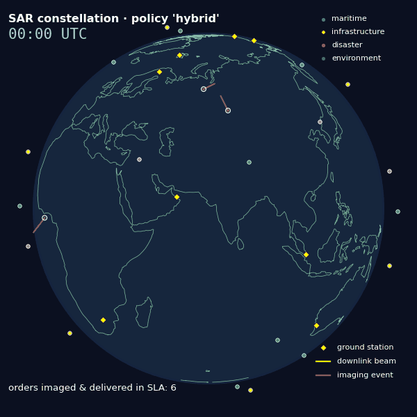
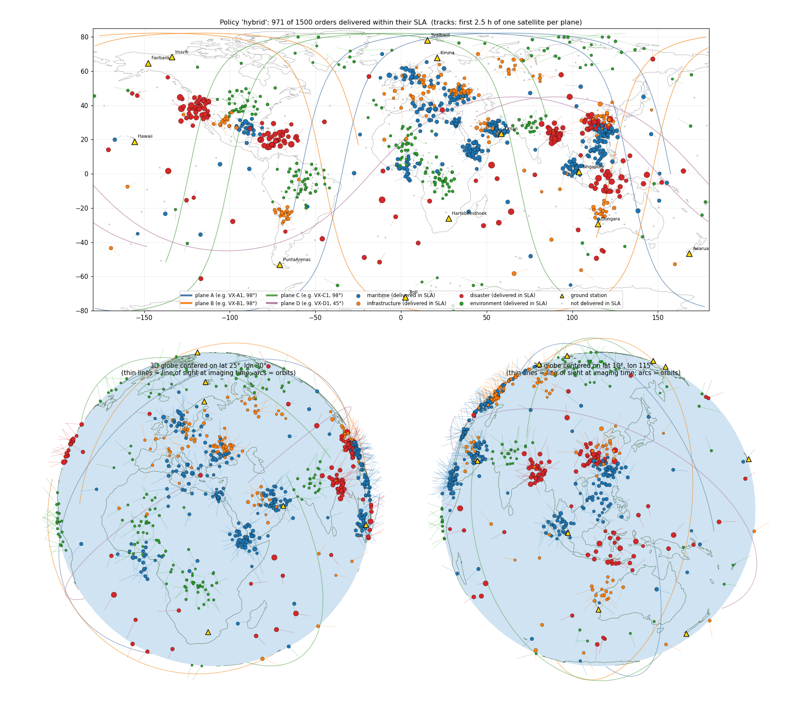
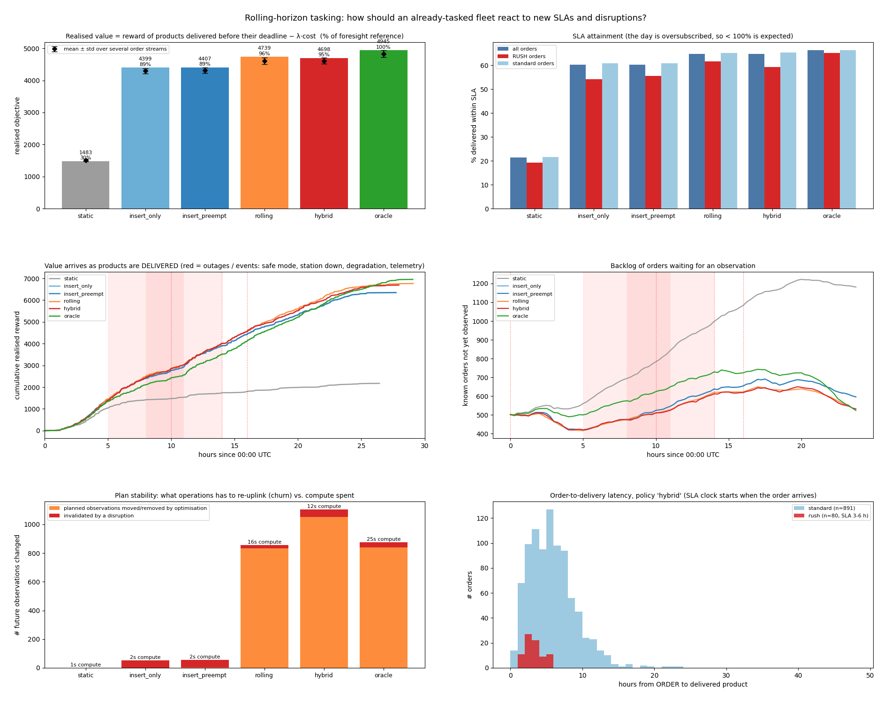
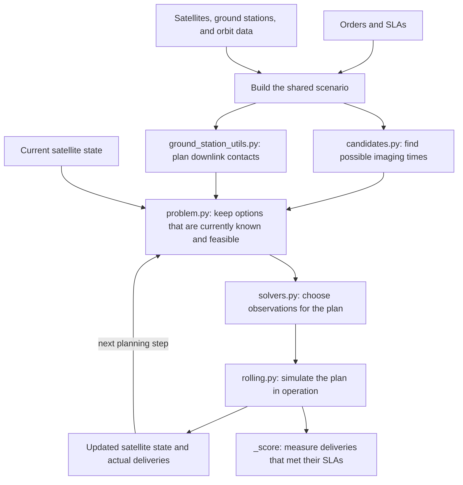
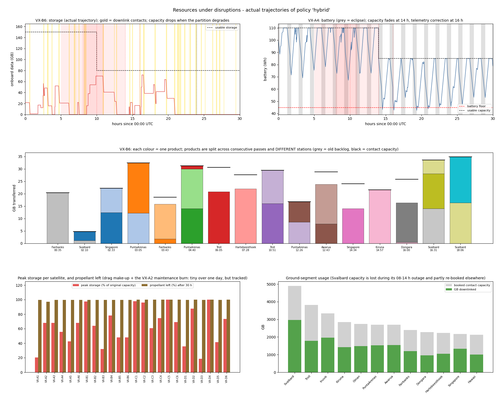

# Rolling-horizon SAR constellation tasking

How should an **already-tasked** SAR constellation react when new customer orders (each with its own **SLA clock**) keep arriving and
things go wrong — a satellite goes into safe mode, a ground station drops out, a storage partition degrades?

This project plans a day of operations for 24 satellites, 12 ground stations and 1 500 orders, then **re-plans continuously from the
current state of every satellite** and scores each strategy by what *actually* got delivered before its deadline.
It models the things that really limit a SAR constellation: onboard storage, **products that take several passes and several stations
to downlink**, battery + eclipse, slew agility, propellant, and a shared ground-station network.

> Illustrative engineering model with plausible (not proprietary) numbers. Not affiliated with, or based on data from, any operator.



*24 h of operations (policy `hybrid`). Coloured dots = orders delivered within their SLA, by category (they accumulate over the day) · red lines = imaging · **yellow diamonds = ground stations**, yellow lines = downlink beams · red ring = satellite in safe mode, red diamond = station down. Regenerate with `python make_gif.py` (options: `--policy`, `--fps`, `--frame-min`, `--size`).*



**Interactive globe:** open `results/globe_3d.html` — pick a policy, press play and **keep rotating the globe while it plays** (gold = downlink beams, red = imaging).
Static dashboards: `results/policy_dashboard.png` (strategy comparison) and `results/ops_dashboard.png` (resources under disruptions).

## 1. The operating question and the options

| Strategy | What it does | Changes to the plan |
|---|---|---|
| `static` | plan once from the day-start backlog, never update | none |
| `insert_only` | every 15 min put new orders into **free** capacity; never move anything | very few |
| `insert_preempt` | as above, but **rush** orders may displace lower-value observations | very few |
| `rolling` | hourly full re-optimisation (greedy fill + LNS) from the current state | many |
| `hybrid` | 15-min insertion with rush preemption **plus** hourly re-optimisation | many |
| `oracle` | knows future orders (reference only; also has no acquisition failures) | n/a |

All of them respect a **freeze window** (observations starting within 15 min are already uplinked and cannot change) and a **planning horizon** (8 h).
Every policy is scored from the simulator's *realised* outcome, never from its own plan.

### Results (realised value = Σ reward of products delivered before their deadline − λ·cost)

Main stream (1 500 orders) and mean ± std over 4 further independent order streams:

| Strategy | Main stream | % of oracle | 4 other streams (mean ± std) | Orders in SLA* | **Rush** orders in SLA* | Plan changes / day* |
|---|---:|---:|---:|---:|---:|---:|
| static | 1 483 | 30 % | 1 513 ± 32 | 21 % | 26 % | 0 |
| insert_only | 4 399 | 89 % | 4 298 ± 82 | 61 % | 58.5 % | 46 |
| insert_preempt | 4 407 | 89 % | 4 317 ± 88 | 61 % | 60.4 % | 50 |
| rolling | 4 739 | 96 % | 4 608 ± 97 | 65 % | 61.5 % | ≈ 1 040 |
| **hybrid** | 4 699 | 95 % | 4 609 ± 96 | 65 % | **63.9 %** | ≈ 1 080 |
| oracle (reference) | 4 945 | 100 % | 4 832 ± 108 | 66 % | 68.9 % | ≈ 800 |

\* mean over the 4 other streams.

What this says (and what it does not)

* **Ignoring new orders is a disaster** (30 % of the reference). **Cheap insertion alone already reaches ~89 %** with almost no plan churn — the first thing any operator should have.
* **Re-optimising adds ~7 % objective but changes ~20× more of the plan** (each change is an uplink to re-do and a customer-visible schedule move). Whether that is worth it is an operational decision, which is why churn is measured.
* **Rush handling is where event-driven logic pays off**: preemption lifts rush attainment by ~2 points in both families, and `hybrid` matches `rolling` on total value (4 609 vs 4 608) while serving **2.4 points more rush orders** — an hourly replan cannot react to an order that arrives between ticks.
* The foresight reference is **not an upper bound** (it also has no acquisition failures, 3 % lost in the others). It holds capacity back early in the day (see the cumulative-value panel) to win later.
* SLA attainment saturates near 65 %: the day is **oversubscribed** by design, so the question is *which* orders to serve.

### Batch solver comparison (all orders known, plan from t = 0, verified feasible)

| Solver | Objective | % of LP upper bound |
|---|---:|---:|
| Greedy (score) | 5 006 | 98.7 % |
| Greedy (value per scarce resource) | 4 881 | 96.2 % |
| GRASP | 4 886 | 96.3 % |
| **LNS (ruin & recreate)** | **5 022** | **99.0 %** |
| LP relaxation (upper bound) | 5 072 | |

Honest note: ranking by value-per-resource was the better greedy in an earlier prototype and is the *worse* one here — ranking heuristics are problem dependent, which is why LNS starts from the better of both. The LP bound ignores slew geometry and queue delays, so the true gap is smaller than shown.



## 2. Model

**Orders and SLAs** (`event_creator.py`, `sla_generator_utils.py`). Orders cluster around real-world hotspots in four categories. Each has an *arrival time* (the planner knows nothing earlier), a priority (standard / **rush**: SLA 3–6 h, ×1.8 reward) and an **SLA measured from order to fully delivered product**. The stream has a day-start **backlog** (~1/3 of orders, "already tasked"), a daily wave and **disaster bursts**.

**Satellites** (`satellite_creator.py`): circular orbits + Earth rotation, true line of sight, signed roll, two hardware generations (storage, battery, solar, downlink rate, agility, propellant), products with different resolution / dwell / **data volume / power**.

**Live satellite state** (`satellite_update_utils.py`): `SatState` = battery, the downlink queue (products still on board), roll, fuel, current capacities, outages. `advance_state` executes observations and rolls the state forward; `apply_outage / apply_maintenance / apply_capacity_change / apply_telemetry` are the external changes. The planner always plans **from a snapshot, not from t = 0**.

**Ground segment** (`ground_station_creator.py`, `ground_station_utils.py`): 12 stations; geometric passes → contact plan with antenna contention, only 60 % of passes bookable (shared network), setup/guard times, no imaging while pointing at an antenna. `apply_station_outage` cancels and **re-books** contacts.

**Resources** (`resources.py`): battery (solar, eclipse from the Sun on 2 Nov, bus/radio/imaging/slew loads, clipping at capacity) and storage + FIFO downlink queue are evaluated with closed-form vectorised recursions (≈ 0.3 ms per satellite for a 30 h timeline):

* battery `x = y − max(0, cummax(y) − Cap)`  ·  queue (Lindley) `q = C − min(0, cummin(C))`  ·  FIFO delivery = first step where cumulative departures ≥ cumulative arrivals.

A product is delivered only when **all** its bytes have left, possibly over several contacts and several stations. An **independent step-by-step simulator** re-checks every plan; tests assert exact agreement.

**Planning** (`candidates.py`, `problem.py`, `solvers.py`): a static pool of ~93 k candidate observations, and a `Problem` *view* at time *t*: known orders only, not yet observed, inside the horizon, still able to meet their SLA, evaluated from the carried-over states. Moves: greedy insertion (marginal-objective test), **preemptive insertion** (`repair_insert`), LNS ruin-and-recreate (frozen observations protected), LP upper bound.

**Disruptions** (`rolling.py`, announced while operating): VX-C2 safe mode 05–11 h · Svalbard down 08–14 h · VX-B6 storage 150→80 GB at 10 h · VX-A4 battery fade + solar −10 % at 14 h and a telemetry correction at 16 h · a known VX-A2 maintenance burn (consumes propellant). *Fuel* is modelled as drag make-up plus maintenance burns; it blocks imaging during a burn but does not limit tasking itself.

### How opportunities become a schedule

The project has two different planning steps: first it finds **what could be done**; then an optimizer chooses **what to do**. The first step generates options. The second step solves the scheduling problem.



* `candidates.py` and `ground_station_utils.py` prepare opportunities and downlink contacts. They do **not** decide which customer orders win.
* `problem.py` removes choices that are unknown, outside the planning window, or infeasible with the satellite's current state.
* `solvers.py` chooses a set of observations from the remaining choices. **This is the optimization step that builds the schedule.**
* `rolling.py` simulates what happens, updates the satellite states, and replans as orders or disruptions arrive. The final score is based on products actually delivered before their deadlines, not just on planned observations.



## 3. Layout
```
sartasking/
  geo.py                    Earth / Sun geometry, eclipse, LTAN→RAAN
  event_creator.py          Event (task) + hotspot-based spatial/product demand
  sla_generator_utils.py    arrival times, SLAs, rush priority, bursts, day-start backlog, order stream
  satellite_creator.py      products, Satellite spec + orbit propagation, hardware generations, fleet
  satellite_update_utils.py live SatState: advance_state, outages, maintenance/fuel, capacity changes, telemetry
  ground_station_creator.py GroundStation + station network
  ground_station_utils.py   passes, contact plan, station outage + re-booking
  candidates.py             vectorised access + candidate observations
  resources.py              battery / storage / FIFO downlink model (fast + independent slow simulator), anchorable
  problem.py                CandidatePool, Problem (view at time t), Plan, verification
  solvers.py                greedy, GRASP, LNS, preemptive insertion, LP bound
  rolling.py                disruptions, policies, rolling simulator, realised-outcome scoring, multi-stream study
  viz.py                    figures + interactive globe
tests/                      23 tests (+ headless Node test of the globe controls)
run_demo.py                 full study
make_gif.py                 renders results/globe.gif for the README
```

## 4. About the 3D globe
Plotly's animation frames redraw the whole scene (and re-apply the camera) every frame, which makes the globe hard to rotate while playing.
The globe now uses **no Plotly frames**: a small JavaScript loop updates only three moving traces (satellites, downlink beams, imaging lines) with `Plotly.restyle`, which never touches the camera. Controls (policy, play/pause, speed, time slider) are in the bottom-left. The control logic is unit-tested headlessly with Node (`tests/globe_js_harness.js`).

## 5. Run
```bash
pip install -r requirements.txt
python run_demo.py            # ~6 min: main stream + 4 extra streams + batch comparison + all figures
python run_demo.py --quick    # ~1.5 min: main stream only
python -m pytest -q           # 23 tests
```

## 6. Limitations and next steps
* Circular orbits, spherical Earth (→ SGP4/J2, WGS-84); contact plan is booked before tasking (→ joint tasking/contact optimisation).
* **Admission control** (quote an SLA only if the current plan can meet it, or counter-offer) is the natural next feature: `Problem` + `try_insert` already give the feasibility check.
* No sun-angle/thermal/processing-latency constraints; one observation per task (→ revisit/stack requests).
* Disruptions are applied to planner and reality at the same moment; real operations also have detection and uplink latency.
* Heuristic optimisers with an LP bound (→ time-indexed MILP / column generation per satellite).
